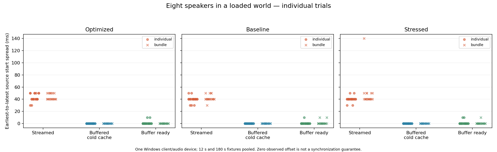

# Jukebox synchronization lab

Isolated Minecraft 26.3 / Java 25 experiment. Nothing is installed on the live server. Synchronization feasibility is tested before implementing copper wire or speaker blocks.

## Implementation decision from the real-song comparison

**Implement buffered playback for connected speaker groups. Keep ordinary streaming for standalone jukeboxes. A mandatory custom client audio engine is not justified for the current server-only goal.** Buffering fixes a substantial measured problem when several speakers overlap. Further client work would mainly provide guaranteed grouped starts, bounded streaming memory, faster first playback and seeking; correctly aligned buffered playback already matches the recorded ideal within the measurement floor. An atomic start control was tested, but a complete custom shared-stream engine was not implemented or benchmarked.

The [main comparison](results/compare-main-analysis.json) completed **97 trials and 17 actual output captures** using the same full 300.6-second music file, eight positions and source gains. The client ran Fabric, Sodium and observation code; its packet-start sound scheduling and decoding were unchanged. Lithium and Polymer were absent from this particular comparison. Both reference and candidates used the G733 endpoint. This closes the missing real-song streamed baseline in the earlier music experiment below.

| Method | Start spread, median / maximum | Starts exceeding one 48 kHz sample | Median recorded waveform residual |
|---|---:|---:|---:|
| Ordinary streamed sound | 75 / 80 ms | 4/4 | 88.080% |
| Buffered, cold decoded cache | 0 / 0 ms | 0/44 | 0.04371% |
| Buffered, actual cached replay | 0 / 10 ms | 5/44 | 0.04370% |
| Atomic client reference | 0 / 0 ms | 0/2 | 0.04378% on the repeated reference |

The four recorded starts per packet-start method lasted 15 seconds; another 40 cold/replay pairs observed 0.25-second rapid starts without endpoint capture. All five replay mismatches occurred in these rapid trials. Their frequency is a result for that artificial restart workload, not an estimate of failures during ordinary gameplay. The waveform column covers the four captured passages per method, all of which had aligned buffered starts. It therefore does **not** claim that the mismatched replays sounded identical to the reference. Earlier deliberate 10 ms controls below show why such a mismatch matters.

Residual means RMS of the recorded waveform left after fitting one global time shift and scalar gain to the recorded atomic reference, divided by recorded RMS. It is **not a percentage of perceived audio quality**. No time stretching, denoising or local timing correction was applied. The passage is 13.5 seconds long. Streaming was also about 6.34 dB quieter in RMS at the same source volumes; the player defaults to level-matched examples so this does not determine the listening comparison. Every completed capture is retained; none was excluded from this comparison.

Separate **280-second** streamed and buffered captures retained their initial 70 ms and 0 ms separation throughout. Neither relative drift nor a common playback-clock slip exceeded one audio sample. Stream observations add the actual durations of removed queue buffers to the native remaining-queue offset; otherwise queue rotation would look like false drift. This tests almost the whole track, not automatic end-of-song behavior.

**Stress-repeat limitation:** two attempts at the additional real-song suite with four CPU workers exited during client startup, before any trial, with Windows native access violations (`0xc0000005`; the first named `jvm.dll`). They are not counted as passes. Earlier completed fixture stress tests remain documented below, but do not substitute for this missing real-song repeat. Zulu 25.0.5 also had native startup failures during setup, so changing runtimes or delaying the recorder is not an established fix. One earlier setup attempt instead failed because a concurrent build replaced classes while the client ran; that build/launch race is excluded too. [Run audit](results/comparison-run-audit.json).

[Listen and try the blind comparison](local-audio/music-comparison/main/comparison/index.html). [Measured summary figure](results/compare-main.png), [waveform and spectrum](results/compare-main-waveforms.png), [source clocks](results/compare-main-timing.json), [capture manifest](results/compare-main-capture.json). The player selects the upper-median waveform residual per method; its “largest replay error” button means the largest **captured** replay error, not the uncaptured rapid-start mismatch. No human listening-test result is claimed.

### Efficiency and costs

The [actual Minecraft decoder benchmark](results/decoder-benchmark.json) decoded the whole track using `JOrbisAudioStream`, with three warm-ups and five interleaved repetitions per mode. Median CPU time was **5.406 seconds for eight independent streams**, **0.688 seconds for one stream**, and **0.703 seconds for one full shared decode**. Sharing removes about 87% of decoder work in the eight-source case, saving roughly **1.6% of one CPU core averaged over the five-minute song**. A single jukebox gets essentially no decoder-work benefit from buffering.

During the main captures, JVM sound-thread CPU occupied a median **1.93% of one core** for streaming, **0.052%** for cold-buffer playback after startup, and **0.104%** for cached playback. These counters exclude the native mixer and driver. Eight spatial sources still need mixing; no FPS or whole-system speedup is established. The isolated decoder benchmark is the more direct evidence for saved decoding work.

The full buffer contains **27.52 MiB of decoded PCM**, shared by all eight speakers. Their streaming queues contained about **2.95 MiB combined**. These are payload sizes, not total process memory or peak decoder allocations. Subsequent cold starts took approximately **0.77–0.86 seconds** in this run; the initial calibration took **3.11 seconds**. Cached starts were below 0.11 seconds. Latency is estimated from submission time and audio playhead, with approximately one mixer interval of uncertainty; it is not physical output latency.

[Inspection of the 22 installed vanilla disc assets](results/vanilla-disc-cost.json) gives **5.98–29.10 MiB per track**, totaling **358.20 MiB** of 16-bit PCM. Avoid eagerly preloading the catalogue. However, on-demand loading only postpones accumulation: the inspected `SoundBufferLibrary` retains full buffers across ordinary stops and clears them when the sound engine is destroyed/reloaded. A resource pack cannot impose a per-song eviction policy. A custom client sharing a short decoded stream between sources could reduce this memory cost, but that is a design opportunity, not a tested implementation here.

### Scope of the recommended implementation

Use separate buffered sound aliases for wired networks, all referencing the same underlying file. Dispatch the master and speakers together; suppress the master's original streamed event for that network. Keep one disc per network and preserve positional sources. Additional redstone timing or packet batching cannot create the missing client-side atomic start operation.

Before shipping, integrate end-of-song behavior: [local code inspection](results/code-inspection.json) confirms `JukeboxSong.hasFinished` adds only **20 ticks** to the declared duration, after which the server sends stop event 1011. Loading slower than that grace period can truncate the ending. The test directly dispatched jukebox events, so this automatic lifecycle was not exercised. Explicit removal must still stop playback promptly. Late joining/seeking, pack delivery to an unmodified client, multiple machines and moving listeners remain separate integration work. Buffering does not solve them.

The evidence supports a substantial practical improvement for overlapping speakers and no measurable additional waveform benefit from atomic starting in already aligned runs. It does not establish a universal phase-lock guarantee or that no future optimization can exist. A required client mod becomes worthwhile if **guaranteed starts, seeking or bounded cache memory** are requirements; for the current vanilla-client goal, the buffered approach is the appropriate next implementation.

To reproduce the comparison:

```powershell
python tools/run_music.py 'C:\path\to\music.mp3' --name compare-main --compare --sodium-only --rounds 4 --seconds 15 --long-seconds 280 --quick-rounds 40
python tools/analyze_comparison.py build/compare-main
python tools/run_music.py 'C:\path\to\music.mp3' --name compare-stressed --compare --sodium-only --stress 4 --rounds 3 --seconds 12 --quick-rounds 40
python tools/analyze_comparison.py build/compare-stressed
```

Use fresh run names. The long window must end before the supplied track ends. Do not rebuild Java classes or regenerate runtime assets while a client test is running. Restore the normal development profile afterward with `./gradlew.bat assemble gametestClasses prepareLabClient`.

## Measured result — 26 October 2026

**A server-only speaker network is feasible, but exact synchronization is not guaranteed by same-tick or bundled jukebox events.** Buffered audio greatly reduced the observed offsets. Even a ready buffer occasionally started its sources one 10 ms mixer interval apart.

The main matrix completed **1,080 in-world trials** on Windows using Zulu 25.0.5 and a G733 headset/OpenAL Soft device, without a debugger or JNI checks. Each profile has 360 trials: three loading modes × two packet-delivery methods × two track lengths × three speaker counts × ten repetitions. Values below pool 2/4/8 speakers, both track lengths and both delivery methods; each cell contains 120 trials. This original matrix changed client render distance after connecting and included terrain mesh rebuilding in its first trials. It did not verify that the server received the new client distance; do not treat it as a fully warmed eight-chunk benchmark.

| Loading mode | Baseline: median / max | Sodium + Lithium + Polymer: median / max | Same mods + four CPU workers: median / max |
|---|---:|---:|---:|
| Streamed | 20 / 50 ms | 20 / 50 ms | 20 / 140 ms |
| Buffered, cold decoded cache | 0 / 0 ms | 0 / 10 ms | 0 / 10 ms |
| Buffered, already decoded | 0 / 10 ms | 0 / 10 ms | 0 / 10 ms |

Cold-buffer trials with more than one audio sample of measured offset: **0/120**, **1/120**, **1/120** respectively. Ready-buffer trials: **5/120**, **4/120**, **6/120**. The 140 ms streamed outlier occurred with eight sources, a three-minute fixture and **bundled** delivery. This establishes that bundling does not guarantee synchronization; it does not establish that bundling is generally worse.

Source-start spread changed by at most **0.000034 ms** between the two observations in these world runs. This checks short-term consistency, not full-song drift or physical sound output.

A further [200 direct audio-engine trials](results/direct-controls.json) completed on the same runtime. These include ten 20 ms and ten 50 ms delayed-start controls, which measured **20 ms** and **50 ms** respectively. Those controls validate the clock calculation; their intentional delays are excluded from the world results above. Total primary validation: **1,280 completed trials**, plus separate debugger smoke runs.

After correcting the view-distance handshake and adding a terrain-render wait, [108 additional world trials](results/world-rendered.json) completed with four CPU workers. The server confirmed the client requested eight chunks. Across 36 trials per loading mode, maximum offsets were **60 ms streamed**, **20 ms cold buffered** and **10 ms buffer-ready**. One cold-buffer trial and two ready-buffer trials exceeded one audio sample. This smaller validation set is kept separate from the original matrix. Total completed non-debug trials: **1,388**. [Captured rendered scene](results/speaker-scene.png).



Raw reports: [optimized](results/world-optimized.json), [baseline](results/world-baseline.json), [CPU load](results/world-stressed.json). [Per-scenario CSV](results/summary.csv) separates delivery method, duration and speaker count. [SVG figure](results/start-spread.svg) is available for export. Earlier debugger smoke reports are retained separately and excluded from the main comparison.

The current prototype includes actual server-event tests, a manual listening scene and client/debug configurations. Copper-wire connectivity, resin behavior and speaker recipes are **not implemented yet**. The recommendation for that next increment is one disc per connected network, buffered audio, simultaneous event dispatch and an explicit best-effort timing limitation. Do not advertise it as phase-locked audio.

## Recorded music comparison

The user-supplied **Midnight In A Perfect World** MP3 was tested through eight spatial sources in the rendered world. The full 300.6-second track was downmixed to mono at 48 kHz and encoded to Vorbis once, then loaded as a shared non-streamed buffer. Six cold-cache starts used ordinary vanilla jukebox packets in one server-tick bundle. Each start was observed for at least 20 seconds; the waveform comparison uses an aligned 18.5-second excerpt. No debugger was attached.

Actual stereo output was captured using Windows WASAPI endpoint loopback on **Realtek speakers**, a different device from the earlier G733 matrix. The reference is a recording of the **same eight sources, positions and gains**, rewound and started together with `alSourcePlayv`. That reference operation is a client-only control, not a claimed server-side capability. Alternate sources were advanced by exactly 480 or 2,400 samples for the 10/50 ms positive controls, then all eight were started atomically. Both control offsets were verified by the native audio clock.

| Recording | Maximum measured source spread | Residual RMS after one global alignment and gain fit |
|---|---:|---:|
| Five clean vanilla packet-start recordings | 0 ms | 0.190–0.319% (−54.4 to −49.9 dB) |
| Repeated atomic reference | 0 ms | 0.296% (−50.6 dB) |
| Deliberate 10 ms relative offset | 10 ms | 59.10% |
| Deliberate 50 ms relative offset | 50 ms | 62.25% |

All six normal starts had zero measured source spread, unchanged through their observation windows. The five clean recordings have waveform correlation **0.9999949–0.9999982** with the reference. Their spectrum and waveform closely overlap the reference, while the 10 ms control shows regularly spaced cancellation notches. No time stretching, local timing corrections, denoising or equalization was used. The residual is close to the repeated-reference floor, so it cannot all be attributed to synchronization error. Local waveform alignment stayed unchanged at the 48 kHz sample resolution in every candidate; this is not a full-song drift measurement.

**Recording contamination:** `candidate-01` contains an extra short tone near 392 Hz before the track begins, and a similar tone during playback. Its total residual is 6.30%; the tone's origin is unconfirmed. That recording remains in all reports and listening files, and is explicitly excluded only from selecting the main listening example. The example is `candidate-06`, the **largest residual among the five clean recordings**, not the best take. No capture reported an overflow or clipping. Endpoint loopback records other sounds routed to the same device; it does not isolate the Minecraft process or measure analog/acoustic output.

[Open the local comparison player](local-audio/midnight-in-a-perfect-world/listening/index.html), [eight-speaker recording](local-audio/midnight-in-a-perfect-world/listening/eight-speakers.wav), [aligned reference](local-audio/midnight-in-a-perfect-world/listening/reference.wav), and [waveform/spectrum figure](results/music-waveform-comparison.png). The player retains playback position when switching and applies one common gain to every version. Its amplified subtraction residual is labeled separately. Recordings stay in ignored `local-audio/`; private music assets stay in ignored `build/` and are absent from the distributable mod jar.

Auditable results: [waveform analysis](results/music-output-analysis.json), [native source timing](results/music-source-timing.json), [capture manifest](results/music-capture.json). This supports good practical buffered playback for this device and scene, while leaving rare startup mismatches and other devices unresolved. Full-track cold decoding also adds a startup wait shared by the speakers; that wait is different from inter-speaker misalignment.

To repeat using a locally supplied track:

```powershell
python -m pip install numpy scipy matplotlib PyAudioWPatch
python tools/run_music.py 'C:\path\to\music.mp3' --name my-music-run --rounds 6 --seconds 20
python tools/analyze_music.py build/my-music-run
```

FFmpeg must be on PATH. Run names must be new directories. The analyzer accepts explicit `--exclude-from-selection <recording>` with a required `--exclusion-reason`; exclusions never remove measurements or audio. The captured reference and controls follow [OpenAL's simultaneous-source start approach](https://openal.org/pipermail/openal/2017-December/000671.html); the endpoint recorder uses [PyAudioWPatch](https://github.com/s0d3s/PyAudioWPatch).

## Client and debugger

Run `./tools/install-runtime.ps1` once, then `./gradlew.bat prepareLabClient` here. Select **Jukebox Sync Lab - Client Debug** in IntelliJ and use Debug. This is an Application configuration attaching directly to Minecraft. The generated local `.iml` supplies source navigation and the pinned runtime dependencies to the parent workspace. Re-run the preparation task after source or dependency changes. The client runs the experiments and exits automatically. On a fresh checkout, add the generated `jukebox-sync-lab.iml` as a module to the parent IDEA project, or open this standalone Gradle project and run `runClientGameTest`.

The installer downloads a pinned Azul Zulu **25.0.5** runtime from its publisher and verifies SHA-256. It stays under this experiment's ignored `.runtime/` directory. IDEA and `run-lab.ps1` use it; Gradle compilation still requires an installed Java 25 JDK. System Java and the live server are unchanged. `run-lab.ps1 -Java <executable>` overrides the launch runtime.

The default development profile includes Sodium 0.9.2, Lithium 0.26.2 and Polymer 0.18.4, all for Fabric 26.3. FastBoot has no confirmed 26.3 release on its [publisher page](https://www.curseforge.com/minecraft/mc-mods/fastboot), so it is not installed. `-Pbaseline` omits all three optional mods. Run preparation again without that option to restore the development profile.

**Jukebox Sync Lab - World Test** runs a temporary dedicated server bound to loopback, creates normal terrain with seed 1, and sends real jukebox level-event packets to the client. It compares individual packets and packet bundles, with world ticks/rendering advancing during observation. There is one jukebox and seven note blocks; the receiving block does not need its own disc for the client to play an event at that position. The fixture assets are installed locally in the client. Polymer auto-hosting is disabled in this lab to avoid an unrelated resource-pack prompt; pack delivery to an unmodified client is not part of this test.

**Jukebox Sync Lab - Play Client** starts a normal client without the automated test runner. Create a creative world with commands enabled. Run `/function synclab:build_demo` at an empty location, then from the same position run `/function synclab:start_streamed`, `/function synclab:start_buffered` or `/function synclab:start_preloaded`. `/function synclab:stop` stops the probe. These manual comparisons use vanilla `playsound` commands; the automated world test uses actual jukebox level events. Keep record volume low for the test tones.

Use Run instead of Debug for timing measurements. Breakpoints, expression evaluation and debugger overhead can affect timing. A safe observation point is the `results.add(result)` line, after both measurements have been collected.

## Repeatable measurements

From this directory in PowerShell:

```powershell
./tools/run-lab.ps1 -Rounds 20 -Full -RunName optimized
./tools/run-lab.ps1 -Rounds 20 -Full -Baseline -RunName baseline
./tools/run-lab.ps1 -Rounds 20 -Full -StressThreads 4 -RunName stressed
./tools/run-lab.ps1 -Network -Rounds 10 -Full -RunName world-optimized
./tools/run-lab.ps1 -Network -Rounds 10 -Full -Baseline -RunName world-baseline
./tools/run-lab.ps1 -Network -Rounds 10 -Full -StressThreads 4 -RunName world-stressed
```

Generated JSON reports are under `results/`. Each includes the device, loaded mod versions, scenario, every source's audio-clock measurement, and completion status. `python tools/summarize.py results/optimized.json` validates the report and summarizes offsets.

The test audio is an original generated tone with a short pulse every second, available in 12-second and 180-second versions. Regenerate it with `python tools/generate_audio.py` (requires FFmpeg). Record volume is low during the test; sources must not be muted because Minecraft otherwise skips playback.

## What is measured

Each scenario submits 2, 4 or 8 sounds through the same `SimpleSoundInstance.forJukeboxSong` factory used by `LevelEventHandler`, followed by the unmodified `SoundManager`, `SoundEngine` and `Channel` playback path. The three cases are streamed, non-streamed with an empty decoded cache, and non-streamed with the decoded buffer already resident. The last case explicitly waits for the vanilla buffer-loading future before issuing starts; this measures the ready-buffer case, not whether the server can observe client readiness.

Observation runs on Minecraft's sound thread. OpenAL's `AL_SEC_OFFSET_CLOCK_SOFT` returns the source offset and device clock as an atomic pair. Subtracting the offset from the clock estimates the source's start time; the difference between the earliest and latest source is the group spread. Two observations, 200 ms apart, check stability. This avoids treating the interval between Java calls as audio alignment. See the [OpenAL device-clock specification](https://openal-soft.org/openal-extensions/SOFT_device_clock.txt).

Scenarios are shuffled with a fixed seed. Positive controls deliberately separate two preloaded starts by 20 or 50 ms; the 50 ms case must measure at least 30 ms or the run fails. Full runs also exercise a three-minute recording, and the stress option creates CPU load. Cache clearing only empties Minecraft's decoded cache; it does not flush the operating system's file cache.

The initial harness measures one client's audio engine, without network transport. It does not measure physical headphone output, different operating systems/devices, or synchronization between players. A result of zero means no difference was observed through this API in that trial, not that vanilla provides a sample-accurate start guarantee.

The current world harness adds normal terrain, view/simulation distance 8, an 854×480 window, TCP loopback transport, vanilla jukebox-event handling and advancing game ticks. It sets the client view distance before connecting, verifies the server received it, and waits for received terrain meshes to render before sampling. Fabric's gametest framework still controls the loop; it is not an unrestricted manual gameplay benchmark. The local dedicated server shares the client JVM. Neither harness measures WAN jitter or a second player's machine. The 180-second fixture tests the startup cost of decoding a full song; each trial observes its beginning, not three minutes of continuous playback. Its ready-buffer case is loaded explicitly by the observer, rather than preloaded automatically on resource reload.

On this Windows machine, several Temurin 25.0.4.1 launches exited in native code, with Windows Application events reporting `jvm.dll` access violations and a heap-corruption exception. This happened with and without the optional mods, including before measurement began. JNI checks allowed some launches to continue but did not reliably prevent the crash. The underlying cause is not established. The primary non-debug measurements use the separate Zulu 25.0.5 runtime without JNI checks. `-NativeChecks` remains available for diagnosis; reports record diagnostic JVM flags. Do not mix those timings with unchecked runs or count partial reports as passes. The runner rejects incomplete reports. `incomplete-baseline.json` preserves the interrupted old-runtime run and is excluded from the results.

## Protocol and design feasibility

The server's `JukeboxSongPlayer.play` broadcasts level event **1010**, containing a position and jukebox-song registry ID. **1011** stops the sound at that position. There is no playback timestamp, sample offset, future start deadline or client-ready acknowledgement. Server song elapsed ticks control server behavior; they do not tell the client to seek.

The song registry maps the disc's jukebox-playable component to a sound event, description and duration. The client resolves that event through `assets/<namespace>/sounds.json` to an Ogg Vorbis resource. In the inspected 26.3 code, `JOrbisAudioStream` decodes the audio on the client; the server does not decode or stream PCM to players.

The client's `LevelEventHandler.playJukeboxSong` creates a separate `SimpleSoundInstance.forJukeboxSong` per position. `SoundEngine` allocates separate channels and requests audio from `SoundBufferLibrary`. Streamed sources open separate decoders asynchronously. Non-streamed sources can share a complete decoded buffer, and `preload` can prepare that buffer during resource loading. The final channel starts still happen on the client. Aligning redstone/server ticks or bundling packets cannot impose an atomic start on its audio mixer.

Polymer can provide vanilla-compatible wire, speaker items, block appearances and resource-pack distribution. It cannot add a scheduled-start/seek operation to the vanilla client's audio protocol. A resource pack can change streaming/preloading flags without a client mod, so this is the useful server-only avenue to measure.

For the proposed gameplay, one inserted disc can drive an entire connected wire network. Speakers need no duplicate disc: the server resolves the connected positions and emits their playback events together. Copper wire and resin weatherproofing can determine connectivity; paper/cone recipes can define speaker appearances. Cable length should not introduce extra redstone-tick playback delays. Removing a speaker can stop that position independently.

The main limits are phase alignment and joining an already-playing track. Vanilla provides no way to make a newly loaded speaker seek to the current song position. New listeners/speakers should wait for the next song, or the entire group must restart together. Starting just the new speaker at the beginning would create an obvious mismatch.

Decoded mono 44.1 kHz, 16-bit audio costs about **15.1 MiB per three-minute track**, before temporary decoding buffers and overhead. The cached buffer is shared by speakers using that exact sound file on one client. Preloading an entire music catalogue is therefore expensive; cold buffered playback may be the more practical compromise. Exact source-start alignment would need client audio coordination, or a single audible source per listener instead of overlapping independent sources. Spatial filtering/HRTF and the physical output path are additional reasons that matching source clocks alone does not establish identical acoustic phase at the listener.
