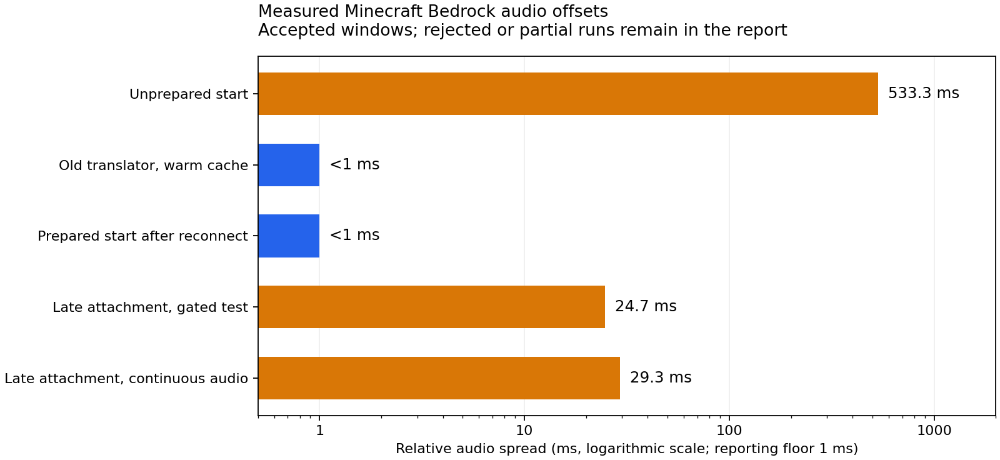

# Copper Speakers on Bedrock

Compatibility work for Copper Speakers 0.2.0 with the local socket-face patch, Geyser-Fabric 2.12.1-b1273 and Bedrock 1.26.60 (protocol 2225). This uses Geyser internals and must be recompiled and checked when Geyser changes. The separate [socket-face patch](copper-speakers-patches/README.md) restricts both wire branches and audio routes to the two wall-plate sockets on Java and Bedrock.

## Current support

Bedrock players need to accept the server resource packs; no client mod is required. Speaker range extension, including custom music, has been confirmed in game on both Java and Bedrock. Wire, resin, wall-plate and speaker-note rendering use generated Bedrock assets and a patched display bridge. Grouped audio preparation addresses independent decoder startup delays. Recorded client tests distinguish initial starts, warm playback and late speaker attachment; late attachment timing remains under investigation. Automated startup and codec tests alone do not measure client audio timing.

| Component | Tested version |
| --- | --- |
| Minecraft Java / Fabric Loader / Java runtime | 26.3 / 0.19.5 / 25 |
| Polymer | 0.18.4 |
| Copper Speakers | `0.2.1+mineandcraft.1` (socket-face patch) |
| Geyser-Fabric | `2.12.1-b1273`, commit `a24ba9c` |
| Bedrock | 26.60, protocol 2225 |
| Copper visual pack / display pack | 1.2.1 / 1.2.1 |

This is a separate server compatibility bundle. Installing the Java mod or stock GeyserDisplayEntity alone is insufficient. Both extension jars, both matching visual packs and the generated mappings are required. Keep the existing music pack for custom songs. Rebuild and retest the integration when Geyser internals, Bedrock protocol, or Polymer model/carrier allocations change.

## Implementation

`CopperBedrock` translates the mod's entity-bound speaker recordings into Bedrock sound handles. Prepared tail events are mapped to the original recording plus Bedrock's playback offset, so Bedrock does not need the large Java tail packs. Moving a parked spare voice starts it at the elapsed song position; deleting a voice stops its handle. The extension also supplies the missing `StopSoundData` event when stopping records: the stock b1273 packet has a null event and crashes the 2225 serializer. Other Bedrock protocols retain Geyser's translators.

`CoordinatedAudio` collects starts for 25 ms, prepares audible sources silently for two seconds, seeks while paused, then allows 250 ms for the seek before releasing the group. Fresh starts preserve the requested opening position. Parked spare voices retain the same clock without allocating a decoder. Each connection receives its own coordinator, so preparation survives reconnects. Ejection, replacement and disconnect cancel pending releases. Attaching a new speaker prepares only that speaker; it must never pause, seek, restart or otherwise update existing speakers. Simultaneous unrelated recordings have separate clocks. Ordinary Geyser records retain a native stop fallback when the coordinator does not own their handles.

### Measuring client audio

The tools in `tools/audio-benchmark/` record only the Minecraft for Windows process through WASAPI process loopback. They do not record the microphone or other applications. Raw WAVs, the private reference Ogg and client screenshots belong in a temporary output directory, outside the repository.

The packet controller makes no world edits. It starts three co-located test handles and keeps source 0 audible continuously. Pair windows compare sources 0+1 and 0+2 at a 2:1 gain ratio; separate source-0 windows check the reference. Volume gating never restarts a source. `production` invokes the extension's entity-audio translator, `late` moves a parked test voice into range, `continuous` keeps the original two voices playing without volume gating and compares their combined 3:1 mixture with a late speaker, and `jukebox` exercises the level-event translator plus two entity voices, clamping only the test jukebox volume and position. Cleanup removes only test handles and test registry entries. Starting a trial stops current audio on the consenting test client to avoid contamination.

Per-packet QPC timestamps detect missing capture time. A persistent SSH connection calibrates server/PC clocks for selecting windows; audio offsets themselves come from simultaneous PCM mixtures matched against the exact recording. Band-limited interpolation is necessary: coarse linear interpolation can imitate a small delay. Synthetic controls include fractional sample positions and known delays from 1 to 533 ms. Report offsets below 1 ms as **below 1 ms**, rather than treating the optimizer's decimals as proven accuracy. Choose the longest contiguous span inside each gate using timestamps only; require at least 0.9 seconds and never select by fit score. Reject low-correlation windows and windows crossing capture gaps, and retain rejected trials in the report. A file lock prevents overlapping trials.

Build the recorder on Windows with `tools/audio-benchmark/build_capture.ps1` (Visual C++ and a Windows SDK are required). On the diagnostic host, use `build_bench.py --classpath <build/classpath.txt> --javac <jdk/bin/javac> --output <diagnostics>` to compile the Java helper against the installed server. Install `DebugAttach` and `audio_rpc.py` using the deployment-specific diagnostic paths in those tools. A new controller suffix is required to replace a class already loaded in a live JVM. The scripts currently target the consenting server operator and must be configured for another deployment before use.

Run `run_trial.py --capture <capture_process.exe> --pid <Minecraft PID> --output <temporary directory> --label <unique label> --mode <mode> --controller <installed controller> --seconds 42`. Place the exact recording in that directory as `reference.ogg`. Python requires NumPy and SciPy; reference decoding requires FFmpeg. Run `analyze_pairs.py <temporary directory>`, then `report.py <temporary directory>` (Matplotlib) for the JSON results, PNG comparison and HTML report. `analyze.py` retains the earlier sequential-solo analysis for historical diagnosis; those estimates cannot separate shared mixer pauses from individual source offsets and are not the accepted timing method.

On the tested Bedrock 26.60 client, a valid unprepared-start window showed approximately 533 ms total spread. Warm playback through the old translator could also align below 1 ms. Repeated prepared-start runs and a production-translator run after reconnect measured below 1 ms in accepted windows. A continuous-playback attachment test, with no volume gating, measured the new speaker 29.3 ms ahead at two points 15 seconds apart. The existing song clock advanced continuously across attachment. That run had no dropped frames, timestamp errors, clipping or listener movement. Late attachment remains unresolved and deliberately leaves existing sources uninterrupted. These measurements do not establish timing parity for every song or client. The [measured results](tools/audio-benchmark/validation-2026-10-28.json) retain accepted and rejected trials.



Java `MARKER` spawn packets are retained as audio positions without spawning a Bedrock actor. Stock b1273 has no marker entity factory and throws when asked to spawn these anchors; the extension handles the marker before Geyser's entity translator.

Minecraft 26.3 anchor movement can contain steps and a null end position. The extension uses the last step, ignores empty or unchanged movement, and retains a separate sound handle and playback clock for every anchor. The previous null dereference was observed in the live log when spare voices moved to their sources. `/copperbedrock voices` shows each Bedrock listener's translated entity voices, playing/parked state, position, sound, and handle; use it while a record plays to verify that the jukebox and connected speakers are represented separately.

`convert_visuals.py` converts the exact live Polymer pack's Copper Speakers carrier states and cuboid models into Bedrock geometry, an atlas, inventory icons, and Geyser JSON mappings. It uses original textures from the mod and the Minecraft 26.3 client jar. The 0.2.0 release omits the referenced speaker-note PNG, so those eight tinted sprites use Minecraft's note particle silhouette. Rebuild after a mod change reallocates Polymer carrier states. Increment the visual pack's version if its contents change.

Item displays additionally require [GeyserDisplayEntity](https://github.com/GeyserExtensionists/GeyserDisplayEntity). Source is pinned to `847d7a9a08b49b503c9d4e828de8e3dc7eb384e9`. `build_display.py` recompiles that source with Fabric's relocated protocol namespace and the release jar's relocated Configurate dependency. Its original source archive, release jar, pack, and provenance are retained on the server. Upstream is AGPL-3.0; preserve its license and provide its corresponding source when distributing the built extension.

The visual revision 1.1.0 reflects Java model X coordinates, converts block rotations and upper/lower UVs, and gives the empty resin carrier a valid transparent block material. These coordinate conventions follow [Rainbow's geometry mapping](https://github.com/GeyserMC/Rainbow/blob/master/rainbow/src/main/java/org/geysermc/rainbow/mapping/geometry/GeometryMapper.java). Asymmetric endpoints are covered by regression tests.

`patch_display.py` and `display-native-methods.java.inc` add a Copper-specific native mesh path to the pinned display bridge. `display-models.json` supplies the same model indices to the extension and resource pack. This avoids armor-slot offsets, keeps the Java item-display origin and scale, and cancels Java's item-renderer half-turn. Other display identifiers retain upstream rendering. The eight notes use short-lived Bedrock billboard particles instead of armor attachables. `CopperFrameEntity` replaces only frames holding `copperbedrock:wall_plate` with a plate mesh, retaining the Java entity ID and ordinary frame behavior for all other items, including maps. Both visual packs must be installed together.

## Build and install

Build from this directory on the Linux server against its installed Geyser jar. Python 3 and a JDK are required; the deployed build uses JDK 24 and emits Java 21 extension classes. The Minecraft server itself requires Java 25. The build reads the existing prepared-audio catalogue at `config/copper-speakers/tails/catalog.json`.

```sh
python3 build.py --server /var/lib/pufferpanel/servers/1fc61e68 --output /home/ubuntu/copper-bedrock/build --javac /usr/lib/jvm/temurin-24-jdk-arm64/bin/javac
```

This also runs `ProtocolSmoke` against the installed codec. It reproduces the original stop-packet error, verifies corrected stops and sound handles, round-trips playback offsets, and checks that moved voices retain elapsed playback time.

After generating visuals, rebuild the display bridge with `--display-models /home/ubuntu/copper-bedrock/display-models.json` in addition to its source ZIP, release jar, classpath file, output directory, and compiler arguments. The generated indices and the bridge must match. `smoke_bundle.py --stage /home/ubuntu/copper-bedrock` recompiles an isolated Standalone copy and checks registration without touching the running server. It binds only to loopback port 29132 and stops its process when finished.

Generate visuals on a computer with Python, Pillow and the Minecraft client jar. `java-visuals.zip` must contain the exact generated Polymer Copper Speakers models, textures, item definitions and carrier states; do not substitute assets from a different allocation. The `--icons` directory contains the project's existing inventory images.

```sh
python convert_visuals.py --java-pack java-visuals.zip --client-jar minecraft-client.jar --output output --icons ../../public/images/items
python -m unittest discover -s . -p test_visuals.py
```

Install the two Fabric-compatible extension jars in Geyser's `extensions`, the converted visual pack and upstream `GeyserDisplayEntityPack.mcpack` in `packs`, and both generated mapping JSON files in `custom_mappings`. Keep the existing music pack: the audio extension references its original sound events. Restart during an empty-server window; mappings and extensions need startup registration. Back up replaced files and remove only these compatibility files to roll back.

The prepared-audio event table is embedded from `config/copper-speakers/tails/catalog.json` at build time. Rebuild the extension after that catalogue changes. Bedrock audio timing, visual transforms, wire steps, plates, range entry, attachment, and stopping require in-game verification; successful codec or startup tests do not prove client rendering or audibility.

The deployment scripts and isolated smoke harness contain mineandcraft's server paths, PufferPanel integration and staging layout. They are operational helpers for this installation, rather than general-purpose installers. For another server, use the build outputs and installation paths above, with that server's backup and restart procedure.

## Verification and deployment history

The entries below record each deployment's state at that time. The current status is summarized above; the final restart activates the permanent fixes without the temporary diagnostic hooks.

Installed on the live server on 27 October 2026. Startup at 19:11 UTC confirmed both extensions, 236 block overrides, 44 custom items, two custom entities, and 1,684 prepared-audio event mappings. The pre-install state is backed up in `/home/ubuntu/copper-bedrock/backup-20261027-191001`. Client verification is pending. The deployment helper defaults to waiting for an empty server; `--restart-occupied` is reserved for an authorized restart that disconnects current players.

Revision 1.1.0 adds a third custom entity for wall plates. Local geometry/pack regression tests, the installed Fabric codec tests (including stepped movement), and isolated Geyser startup pass. Installed and restarted at 19:41:49 UTC on 27 October 2026, with all six deployed files matching their staged hashes. Backup: `/home/ubuntu/copper-bedrock/backup-20261027-194041`. The regenerated Polymer model/carrier inputs are unchanged. Both visual packs are version 1.1.0; the working music pack stays at 2.3.0. The live voices command works and reported zero listeners before a client rejoined. In-game rendering and simultaneous audio still require Bedrock verification; startup does not prove either.

Revision 1.2.0 preserves `mineandcraft_music:buffered.*` rather than replacing it with the streaming event. Prepared sounds also use buffered events. Vanilla record aliases reference the original audio paths from [Mojang's Bedrock samples](https://github.com/Mojang/bedrock-samples/blob/main/resource_pack/sounds/sound_definitions.json), copied in `bedrock-records.json`; the converter makes those aliases non-streaming. The user confirmed speaker range extension on both clients after the 20:13:38 UTC restart. Backup: `/home/ubuntu/copper-bedrock/backup-20261027-201224`. Java playback was unchanged; the apparent Java silence was its muted record volume.

The 1.2 visual pack replaces the missing `geometry.full_block` reference with an explicitly packaged invisible mesh. Block defaults use custom thin geometry, and held items use icons rather than unbound meshes. The display bridge keeps the source item's yaw; its previous extra half-turn was observed as Java -180 becoming Bedrock 0 in a live snapshot. The GeyserDisplayEntity pack is now 1.2.1: invalid property aliases and the old interpolation expression are removed, and empty `scripts.initialize` / `scripts.pre_animation` keys are omitted because the actual Bedrock client rejects empty lists. Pack-only hotfix backup: `/home/ubuntu/copper-bedrock/hotfix-20261027-202826`.

`VoxelSupport` repairs only an entirely empty protocol-2225 `VoxelShapesPacket`, supplying the vanilla empty/unit-cube shapes before `StartGame`. Geyser b1273 sends an empty registry; the client log showed missing unit-cube and invalid empty handles. The repair round-trips through the installed codec. It is installed as an outbound hook and preserves nonempty registries. During diagnosis it was activated without restarting Java; a full Bedrock restart and rejoin produced no further voxel registry errors. The corrected extension jar is also persisted for the next server restart.

Diagnostics under `tools/` use the local JVM attach API because the live server has no JDWP session. `LiveSnapshot` reads Geyser state on its event loop and Java network state on the server thread. `DisplayTrace` keeps bounded, read-only observations of outgoing display packets; `TraceControl` reads or clears only that temporary buffer. They do not edit world blocks. The live content log is under `%APPDATA%/Minecraft Bedrock/logs/`; compare new sessions/timestamps rather than treating older errors as current. The client script debugger settings are unrelated to the Java-backed server and JSON resource-pack rendering.

The fresh client log from 21:34 local time contains no Copper display-pack or voxel errors. The outgoing trace shows riser/resin model indices 1–35, unit scale and `INVISIBLE=false`; the latest screenshots show these meshes drawing. Wall-plate spawning additionally needs coherent yaw, head rotation and body rotation. The old manual packet set only yaw, leaving the other rotations at zero. `CopperFrameEntity.spawnPacket` now sets all three; the codec regression checks all four horizontal faces. `RepairPlateRotation` applies the same correction to current actors and new spawns while the existing JVM remains running; the corrected jar is persisted for the next normal restart. Client confirmation of all plate faces is pending.

At 20:59:04 UTC, the server restarted successfully with Copper Speakers `0.2.1+mineandcraft.1` and the socket-face restriction requested by the user. All 45 Minecraft tests and four graph tests passed before installation. Backup: `/home/ubuntu/copper-bedrock/socket-faces-backup-20261027-205749`; receipt: `/home/ubuntu/copper-bedrock/socket-faces-install.json`. Regenerated Polymer inputs match all 105 previous input entries semantically (95 JSON files differ only in formatting). Startup confirmed 236 block overrides, 44 items, three custom entities and 1,684 prepared sound events. The normal restart activates the persisted voxel and plate-rotation fixes and removes the temporary diagnostic hooks. After this deployment, the server operator confirmed that Bedrock functionality had reached parity with Java on the tested setup.

Visual pack 1.2.1 corrects the speaker block front by 180 degrees in all four carrier orientations. Only those four speaker mappings change; wire/display and wall-plate rotations retain their own paths. Three geometry/pack regression tests pass. Installed at 21:36:17 UTC on 27 October 2026; backup: `/home/ubuntu/copper-bedrock/speaker-facing-fix/backup-20261027-213511`. The operator confirmed that the speakers now face correctly. This deployment does not change audio timing.

## Runtime prepared joining

New Copper Speakers joining events encode the original sound and sample offset, so additional prepared songs work without rebuilding this extension. The original Bedrock audio and its buffered definition must already be in the ordinary music pack. Offset playback remains limited to the supported protocol (2225 / 26.60).

Legacy opaque prepared events can also be loaded from `config/copper-speakers/joining/events.json`. The extension refreshes that atomic JSON file in the background and keeps its last valid table on errors. Override its location with `-Dcopperbedrock.preparedEvents=/absolute/path/events.json`. Existing embedded mappings remain a fallback; building an extension no longer requires a legacy catalogue.

The complete local settings/status protocol and wiki integration contract are documented in the Copper Speakers repository at `docs/wiki-music-bridge.md`. Preparation settings are independent of normal song publication. This change has been built and tested locally; it does not install or restart anything on the live server.
